# Exploration des données

On a deux datasets disponibles.

## Munich AML Morphology dataset

Le jeu de données Munich AML Morphology [^1] contient 18 365 images de cellules uniques annotées par des experts, prélevées sur des frottis de sang périphérique de 100 patients diagnostiqués avec une leucémie myéloïde aiguë (LMA) à l'hôpital universitaire de Munich entre 2014 et 2017, ainsi que de 100 patients ne présentant aucun signe de pathologie hématologique maligne. L'acquisition des images a été réalisée à l'aide d'un microscope/scanner numérique M8 (Precipoint GmbH, Freising, Allemagne), avec un grossissement optique de 100 fois et immersion dans l'huile. Les leucocytes pathologiques et non pathologiques ont été classés selon un schéma de classification morphologique standard, dérivé de la pratique clinique, par des experts formés à cet effet. Afin de quantifier la variabilité inter- et intra-observateur des examinateurs, un sous-ensemble d'images a été réannoté jusqu'à deux fois.

Le dataset AML contient 18365 images au format TIFF de taille 400 par 400 pixels avec un canal pour la transparence.

A noter, le dataset AML a un fichier `annotations.bat` qui contient pour chaque image du dataset, une liste d'annotation et de ré-annotation. Certaines images ont donc plusieurs type associés dans le cas où les annoteurs ne sont pas d'accord entre eux. +
On pourra se servir de ces données de différentes manières, par exemple pour supprimer les images où les annotations ne concordent pas ou n'ont pas pu conclure sur le type. On pourrait également s'en servir pour l'analyse des résultats et voir si notre modèle retrouve un des types des différentes annotations.

[^1]: “Matek, C., Schwarz, S., Marr, C., & Spiekermann, K. (2019). A Single-cell Morphological Dataset of Leukocytes from AML Patients and Non-malignant Controls [Data set]. The Cancer Imaging Archive. https://doi.org/10.7937/tcia.2019.36f5o9ld“

## PBC dataset

Le jeu de données PBC [^2] contient au total 17 092 images de cellules normales individuelles, acquises à l'aide de l'analyseur CellaVision DM96 au laboratoire central de l'hôpital clinique de Barcelone. Le jeu de données est organisé en huit groupes : neutrophiles, éosinophiles, basophiles, lymphocytes, monocytes, granulocytes immatures (promyélocytes, myélocytes et métamyélocytes), érythroblastes et plaquettes ou thrombocytes. Les images ont une taille de 360 x 363 pixels, au format JPG, et ont été annotées par des pathologistes cliniciens experts. Les images ont été capturées à partir d'individus sans infection, sans maladie hématologique ou oncologique, et ne suivant aucun traitement pharmacologique au moment du prélèvement sanguin.

Ce jeu de données annoté de haute qualité peut être utilisé pour entraîner et tester des modèles de machine learning et de deep learning afin de reconnaître différents types de cellules sanguines périphériques normales. À notre connaissance, il s'agit du premier ensemble publiquement disponible comportant un grand nombre de cellules sanguines périphériques normales, ce qui en fait un jeu de données de référence attendu pour l'évaluation comparative de modèles.

[^2]: Acevedo, Andrea; Merino, Anna; Alférez, Santiago; Molina, Ángel; Boldú, Laura; Rodellar, José (2020), “A dataset for microscopic peripheral blood cell images for development of automatic recognition systems”, Mendeley Data, V1, doi: 10.17632/snkd93bnjr.1

## Fusion des datasets

Ils contiennent différents type de cellules. Le dataset AML contient plus de types différents et certains types sont séparés en deux catégories différentes. Le dataset PBC contient une catégorie qui n'est pas présente dans le dataset AML, platelet.

En utilisant Claude, on peut voir que certains types de AML peuvent être rattachés à un type du dataset PBC.
On va donc créer un mapping entre les catégories AML et celles de PBC.

| Type (AML) | Rattachement (PBC) | Explication | Caractéristiques visuelles |
|---|---|---|---|
| Basophil | basophil | Granulocyte basophile mature, granules riches en histamine | Granules volumineux violet foncé/pourpre recouvrant souvent le noyau, qui devient difficile à distinguer |
| Eosinophil | eosinophil | Granulocyte éosinophile mature, réponse antiparasitaire/allergique | Granules orangé-rouge, gros, réguliers et réfringents ; noyau bilobé (aspect "lunettes") |
| Erythroblast | erythroblast | Précurseur nucléé du globule rouge | Petite cellule, noyau rond très dense (chromatine condensée en "roue de charrette"), cytoplasme bleu foncé, peu abondant, sans granules |
| Monocyte | monocyte | Monocyte mature, précurseur des macrophages | Grande cellule, cytoplasme gris-bleu "verre dépoli", parfois vacuolé, noyau en fer à cheval/plié, chromatine fine et lâche |
| Lymphocyte (typical) | lymphocyte | Lymphocyte normal, immunité adaptative | Petite cellule, noyau rond dense occupant presque toute la cellule, fin liseré de cytoplasme bleu pâle, pas de granules |
| Lymphocyte (atypical) | lymphocyte | Lymphocyte réactif (stimulation virale/antigénique) | Plus grande taille, cytoplasme plus abondant et plus basophile, noyau irrégulier/indenté, cytoplasme "moulant" les hématies voisines (cellules de Downey, typiques de la mononucléose) |
| Neutrophil (segmented) | neutrophil | Neutrophile mature, phagocytose de première ligne | Noyau à 3-5 lobes reliés par de fins ponts de chromatine, granules fins rose-lilas, cytoplasme pâle |
| Neutrophil (band) | neutrophil | Neutrophile immature (déviation gauche) | Noyau non segmenté en forme de bâtonnet/fer à cheval, mêmes granules neutrophiles que la forme segmentée |
| Myelocyte | ig | Précurseur granulocytaire, stade intermédiaire | Noyau rond à ovale sans indentation, chromatine se condensant, apparition des granules spécifiques, zone de Golgi visible |
| Metamyelocyte | ig | Précurseur granulocytaire, juste avant le stade bâtonnet | Noyau indenté en forme de haricot/rein (indentation < moitié du diamètre), granules spécifiques déjà présents |
| Promyelocyte | ig | Précurseur granulocytaire précoce | Grande cellule, gros noyau rond/ovale avec nucléole visible, cytoplasme chargé de granules azurophiles primaires |
| Promyelocyte (bilobled) | ig (avec réserve — cellule critique) | Marqueur morphologique de la LAM3/APL, urgence vitale | Noyau bilobé/replié, cytoplasme hypergranuleux, présence possible de corps d'Auer multiples groupés en fagots ("faggot cells") |
| Myeloblast | ig (avec réserve — pas une vraie équivalence) | Précurseur granulocytaire le plus immature, un vrai blaste (marqueur LAM), absent du sang sain | Grande cellule, rapport nucléo-cytoplasmique élevé, chromatine fine et ouverte, un ou plusieurs nucléoles visibles, cytoplasme rare peu ou pas granuleux, corps d'Auer parfois présents |
| Monoblast | monocyte (avec réserve — pas une vraie équivalence) | Précurseur monocytaire le plus immature, un vrai blaste (marqueur LAM4/M5), absent du sang sain | Grande cellule, cytoplasme abondant avec pseudopodes et fines vacuoles, noyau rond/plié à chromatine fine, gros nucléole(s) |
| Smudge cell | aucune correspondance | Artefact de frottis, pas une vraie cellule | Amas informe de chromatine étalée/écrasée, sans structure cellulaire ni membrane visible, typique des lymphocytes fragiles de la LLC |
| — (absent du dataset 2) | platelet | Fragment cytoplasmique de mégacaryocyte, rôle dans l'hémostase | Très petite taille (2-4 µm), pas de noyau, granules violets au centre (granulomère) entourés d'une zone claire (hyalomère), souvent groupées en amas |

Ici, on va choisir d'inclure les *Promyelocyte (bilobled)* dans la catégorie *ig* même si ces cellules peuvent avoir un impact fort du point de vue clinique.
Les autres types sans équivalence garderont leur propre type, même si on n'a pas de data venant du dataset PBC.

Dans le dataset PBC, certaines catégories comme *ig* peuvent être détaillés grâce au nom de l'image (`MMY` pour *Metamyelocyte* par exemple).

### Comparaison des datasets

On va afficher un exemple d'image pour chaque type dans chacun des datasets pour comparer.

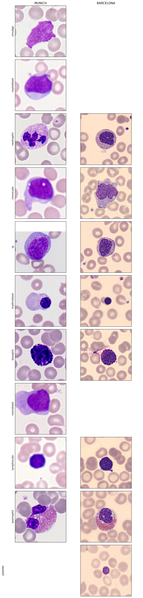

On peut voir que les deux datasets ont des couleurs différentes, notamment pour le fonds. Cela peut poser problèmes pour l'entrainement, où le modèle risque d'apprendre à reconnaitre le dataset plustôt que le type de cellule suivant la répartition de la classe dans les deux datasets.

### statistiques d'image

On va maintenant s'intéresser aux statistiques d'image, telles que les histogrammes de couleurs, la luminosité et le contraste des images.

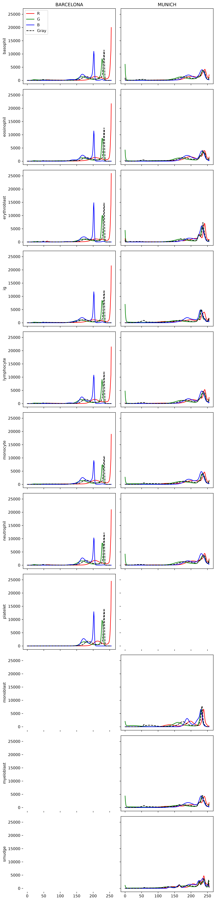

On peut voir que les histogrammes de couleurs sont différents entre datasets, mais pas forcément par type de cellule.

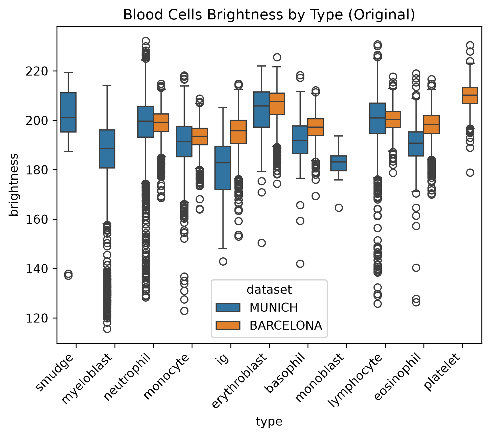
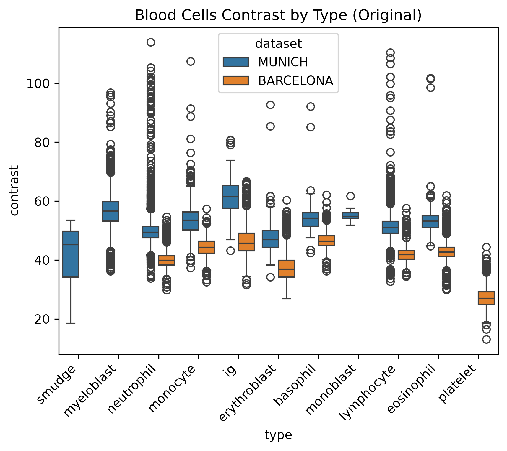

La luminosité et le contraste sont encore une fois différents entre les datasets, mais aussi entre les types de cellule.

### Morphométrie par classe

Taille des cellules, rapport noyau/cytoplasme, forme du noyau

### Normalization

Pour gommer les différences entre les deux datasets, il est possible d'essayer de normalizer les images en ramenant la moyenne et la variance de chaque canal R, G, B de chacun des datasets vers la moyenne et la variance de chaque canal R, G, B de l'ensemble de nos données. 

On peut voir le résultat pour chacun des graphs précédement présentés.

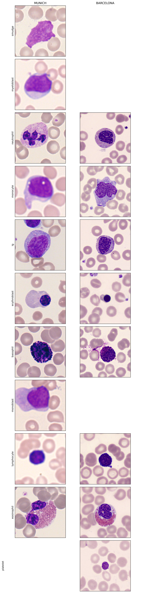
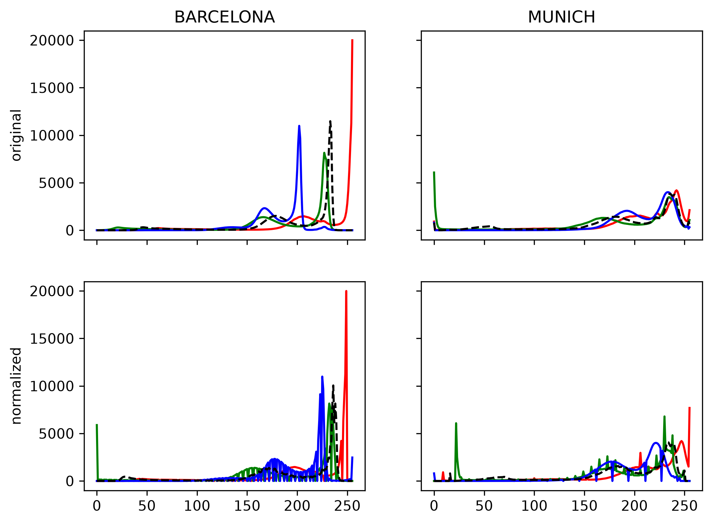
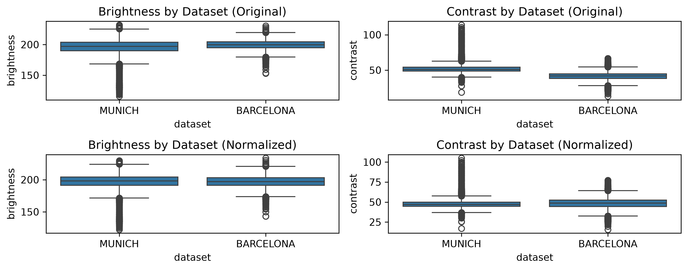

On peut voir que les images sont plus proches visuellement, le fonds étant presque le même entre les datasets.
Pour les histogrammes de couleurs, même si des différences sont encore réélles, on peut voir qu'ils se sont rapprochés l'un de l'autre.
Concernant la luminosité et le contraste, on peut voir que les moyennes sont maintenant alignées entre les datasets.

## Distribution

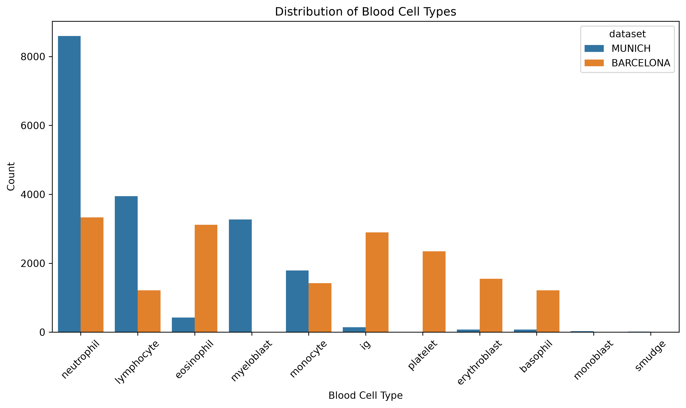

| Type | Pourcentage |
| --- | --- |
| neutrophil      | 33.63% |
| lymphocyte      | 14.56% |
| eosinophil       | 9.99% |
| myeloblast       | 9.22% |
| monocyte         | 9.05% |
| ig               | 8.57% |
| platelet         | 6.62% |
| erythroblast     | 4.59% |
| basophil         | 3.66% |
| monoblast        | 0.07% |
| smudge           | 0.04% |

Les classes *monoblast* et *smudge* sont très peu représentées, à peine 41 images pour les deux classes. Ce n'est clairement pas suffisant pour entrainer un modèle à les reconnaitre.

Pour les classes moins représentées, comme *basophil*, *erythroblast* et *platelet*, on pourra utiliser des techniques d'augmentation telles que des retournements ou des rotations pour obtenir plus d'images dans ces classes.

## Visualisation par réduction de dimension

On effectue une PCA avec 2 composants pour visualiser un sous-ensemble de nos donénes. Cette décomposition n'explique que 18% de la variance des données.

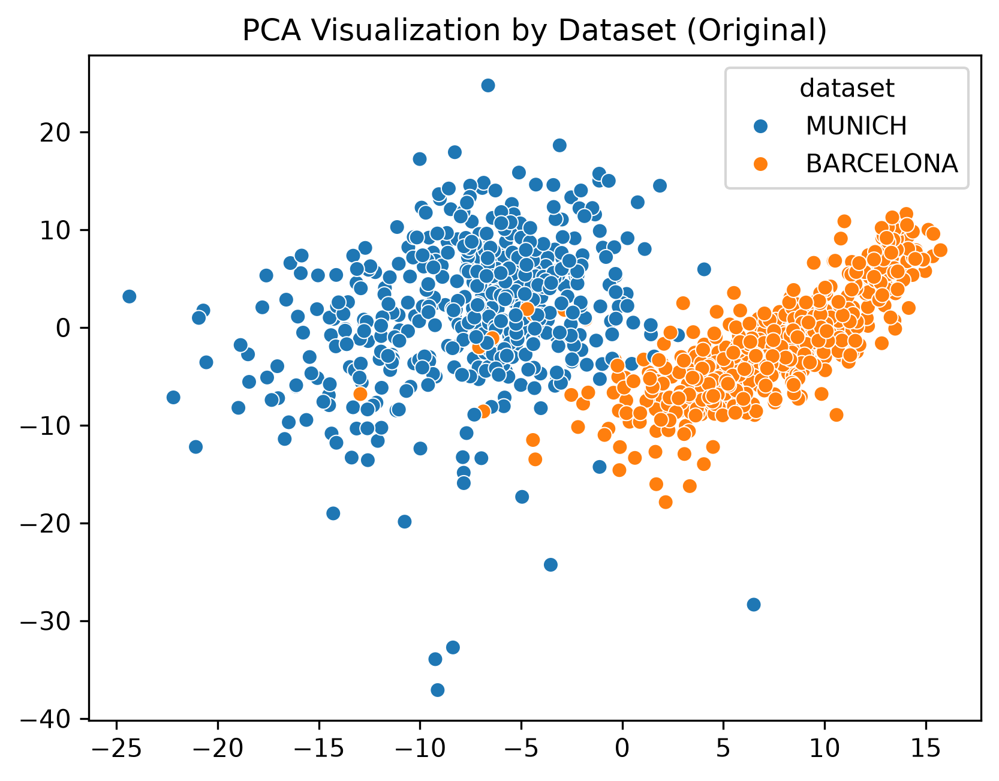

On peut voir que les 2 datasets sont bien séparés dans cette décomposition.

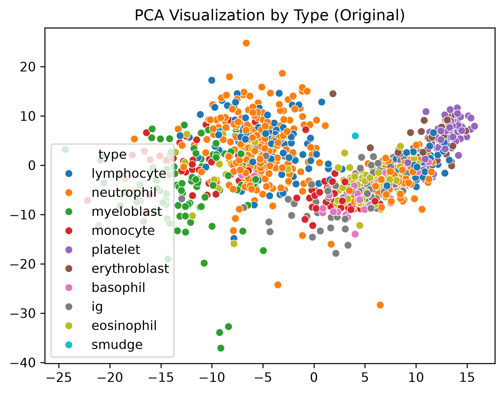

Par contre, les différents types de cellules ne sont pas du tout séparés par cette décomposition.

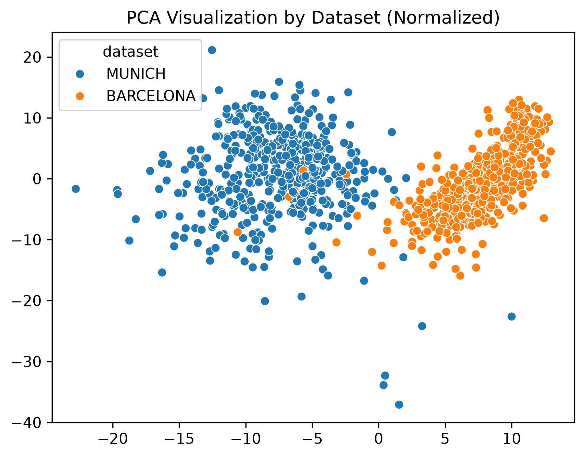

Enfin, on voit que même avec les données normalisées, les datasets restent séparés par une décomposition par PCA.

